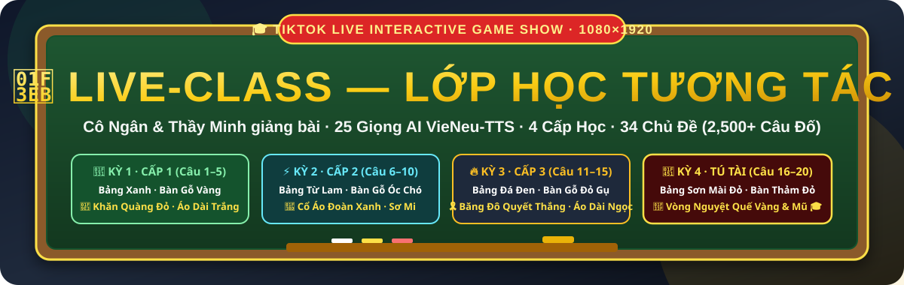
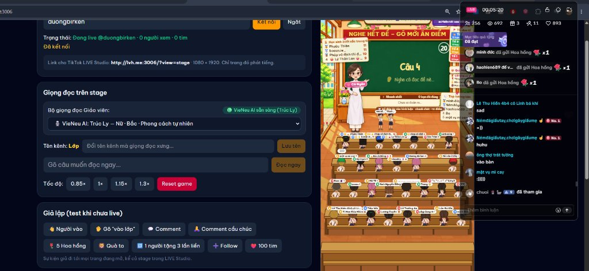
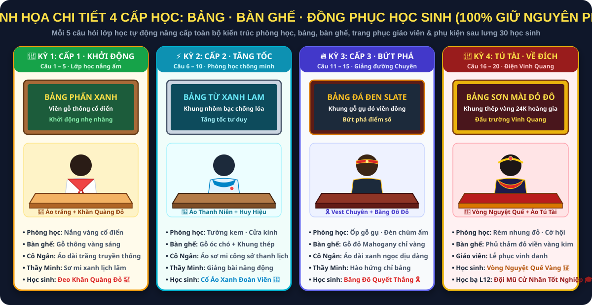
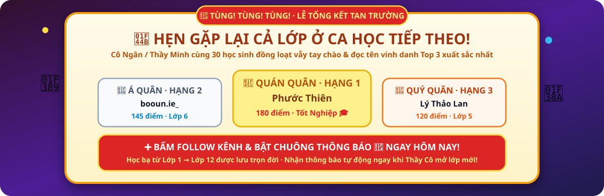

<div align="center">



<br />

# 🏫 LIVE-CLASS — LỚP HỌC TƯƠNG TÁC ĐA CHỦ ĐỀ TIKTOK LIVE

**Game Show lớp học tương tác trực tiếp trên TikTok LIVE (tỉ lệ dọc 9:16 — `1080×1920`)**
*Nơi người xem hóa thân thành học sinh ngồi bàn, giơ tay chinh phục 34 chủ đề kiến thức (Toán nhẩm, Tiếng Anh, Lịch sử, Địa lý, Đuổi hình Emoji, Đố mẹo...), tích lũy Học Bạ từ Lớp 1 đến Tốt Nghiệp Tú Tài 🎓 cùng Cô Ngân & Thầy Minh AI!*

[](https://duongbirken.deta.vn)
[](https://duongbirken.deta.vn)
[](https://duongbirken.deta.vn)
[](https://duongbirken.deta.vn)

---

**Phát triển & Vận hành bởi [Duong Birken](https://duongbirken.deta.vn)**
🌐 Website chính thức: **[https://duongbirken.deta.vn](https://duongbirken.deta.vn)**

</div>

---

## 📖 Mục Lục

1. [Giới Thiệu Dự Án LIVE-CLASS](#-1-giới-thiệu-dự-án-live-class)
2. [Hình Ảnh Thực Tế & Giao Diện Điều Khiển](#-2-hình-ảnh-thực-tế--giao-diện-điều-khiển)
3. [Hệ Thống Nhân Vật & Trang Phục Thực Tế](#-3-hệ-thống-nhân-vật--trang-phục-thực-tế)
4. [4 Cấp Học Tiến Hóa Theo Vòng (Giữ Nguyên 100% Tọa Độ Pixel)](#-4-cấp-học-tiến-hóa-theo-vòng-giữ-nguyên-100-tọa-độ-pixel)
5. [Tính Năng Đột Phá](#-5-tính-năng-đột-phá)
6. [Luật Chơi, Chấm Điểm & Cơ Chế 200+ Người Tham Gia](#-6-luật-chơi-chấm-điểm--cơ-chế-200-người-tham-gia)
7. [Lễ Tổng Kết Tan Trường & Kêu Gọi Follow Kênh](#-7-lễ-tổng-kết-tan-trường--kêu-gọi-follow-kênh)
8. [Hướng Dẫn Cài Đặt & Phát Trực Tiếp (TikTok LIVE Studio)](#-8-hướng-dẫn-cài-đặt--phát-trực-tiếp-tiktok-live-studio)
9. [Tùy Chỉnh Kho 2,500+ Câu Hỏi Đa Chủ Đề & Giọng Đọc](#-9-tùy-chỉnh-kho-2500-câu-hỏi-đa-chủ-đề--giọng-đọc)
10. [Cấu Trúc Thư Mục Dự Án](#-10-cấu-trúc-thư-mục-dự-án)

---

## 🌟 1. Giới Thiệu Dự Án LIVE-CLASS

**LIVE-CLASS** là nền tảng **Interactive Live Game Show** thế hệ mới dành riêng cho **TikTok LIVE** (khung dọc chuẩn `1080×1920`). Không chỉ giới hạn ở một dạng câu hỏi đơn lẻ, **LIVE-CLASS** tái hiện trọn vẹn một lớp học đa môn học và đa hoạt động — nơi toàn bộ luồng bình luận, thả tim, tặng quà và follow của khán giả trên TikTok được kết nối thời gian thực vào lớp học:

- **Vào lớp tự động:** Khán giả chỉ cần bình luận bất kỳ, thả tim, follow hoặc tặng quà là tự động có nhân vật chibi ngồi vào **4 dãy bàn học (30 chỗ ngồi hiển thị trực tiếp)** và được Giáo viên AI gọi tên chào đón.
- **Nội dung đa môn học (34 chủ đề · 2,500+ câu hỏi):** Kết hợp linh hoạt giữa *Toán Tính Nhẩm Siêu Tốc, Đố Từ Tiếng Anh (phát âm bản xứ), Lịch Sử, Địa Lý, Khoa Học, Đuổi Hình Bắt Chữ Emoji, Ghép Chữ Tiếng Việt, Ca Dao Tục Ngữ, Ẩm Thực, Đố Mẹo Dân Gian & Gen Z Trend*.
- **Giáo viên AI thông minh (Cô Ngân & Thầy Minh):** Tự động chuyển đổi nhân vật theo giọng đọc Nam/Nữ. Thầy/Cô giảng bài, đọc câu hỏi, gợi ý, khen thưởng người trả lời nhanh, cảm ơn quà tặng và trò chuyện tự nhiên bằng **25 giọng AI VieNeu-TTS v3 Turbo** chạy trực tiếp trên máy (0đ chi phí API).
- **4 Cấp Học Tiến Hóa Tự Động:** Cứ mỗi 5 câu hỏi, lớp học tự động nâng cấp từ **Cấp 1 (Khởi Động)** ➔ **Cấp 2 (Tăng Tốc)** ➔ **Cấp 3 (Bứt Phá)** ➔ **Tú Tài (Về Đích)** với kiến trúc phòng học, mặt bảng, bàn ghế, trang phục giáo viên và phụ kiện học sinh thay đổi hoàn toàn.
- **Chuẩn An Toàn Cộng Đồng TikTok 100%:** Toàn bộ lời thoại, hoạt cảnh và ngân hàng câu hỏi đã được tối ưu hóa ngôn từ tích cực, vui nhộn, loại bỏ triệt để các từ ngữ nhạy cảm để phiên LIVE luôn được đề xuất mạnh mẽ trên xu hướng (FYP).

---

## 🖥️ 2. Hình Ảnh Thực Tế & Giao Diện Điều Khiển

Giao diện Bảng Điều Khiển (`http://localhost:3006`) của **LIVE-CLASS** được thiết kế đồng bộ phong cách Dark Glassmorphism hiện đại cùng hệ sinh thái **Ai Là Trạng Nguyên**, chia làm 2 cột trực quan: **Cột điều khiển bên trái** và **Màn hình xem trước Stage `1080×1920` thời gian thực bên phải**.

<div align="center">
  
  <p><i>Hình ảnh thực tế phiên LIVE của <b>LIVE-CLASS</b>: Hàng trăm học sinh tương tác cùng lúc, Cô Ngân giảng bài trên bục giảng, bảng xếp hạng Tổ Đua Tài & Top Học Sinh Xuất Sắc cập nhật tức thì.</i></p>
</div>

### Các Khu Vực Trên Bảng Điều Khiển (`http://localhost:3006`)

| Khu Vực Điều Khiển | Chức Năng Chi Tiết |
| :--- | :--- |
| **1. Kết nối TikTok LIVE** | Nhập `@username` kênh TikTok, bấm **Kết nối**. Tích hợp cơ chế tự động kết nối lại thông minh khi mạng chập chờn và cung cấp đường dẫn riêng cho LIVE Studio (`http://lvh.me:3006/?view=stage`). |
| **2. Giọng đọc trên Stage** | Chọn ngay **25 giọng đọc AI VieNeu-TTS** (14 Nam · 11 Nữ). Khi chọn giọng Nam (VD: *Adam bựa*, *Bình*, *Tuyên*), nhân vật trên sân khấu tự động đổi sang **Thầy Minh** và xưng *"Thầy"*. Khi chọn giọng Nữ (VD: *Trúc Ly*, *Ngọc Huyền*), sân khấu tự động hiển thị **Cô Ngân** và xưng *"Cô"*. |
| **3. Bộ giả lập Test Offline** | 9 nút giả lập nhanh (*👋 Người vào, ✋ Gõ "vào lớp", 💬 Comment, 🙋 Comment câu chúc, 🌹 5 Hoa hồng, 🦁 Quà to, 🔁 Combo x3, ➕ Follow, ❤️ 100 tim*) giúp kiểm tra toàn bộ hiệu ứng trước khi lên sóng. |
| **4. Điều khiển LIVE-CLASS** | Đổi nhanh **4 Cấp Học** (*🌱 Kỳ 1 Cấp 1 · ⚡ Kỳ 2 Cấp 2 · 🔥 Kỳ 3 Cấp 3 · 👑 Kỳ 4 Tú Tài*), kích hoạt **Giờ Ra Chơi**, mở 2 Game Lớn (**🏔️ Đường Lên Đỉnh Everest** & **🔔 Rung Chuông Đồng**), hoặc bật màn hình **👋 Tan trường**. |

---

## 🧑‍🏫 3. Hệ Thống Nhân Vật & Trang Phục Thực Tế

**LIVE-CLASS** sở hữu bộ sprite nhân vật `.webp` độ phân giải cao với hàng chục biểu cảm và tư thế hoạt cảnh riêng biệt:

### 👩‍🏫 Cô Giáo Ngân — 5 Bộ Trang Phục Theo Cấp Học & Sự Kiện

| Áo Dài Trắng (Cấp 1) | Sơ Mi Công Sở (Cấp 2) | Áo Dài Xanh Ngọc (Cấp 3 & Tú Tài) | Đồ Leo Núi (Đỉnh Everest) | Lễ Phục (Rung Chuông Đồng) |
| :---: | :---: | :---: | :---: | :---: |
|  |  |  |  |  |
| *Dịu dàng đón học sinh mới vào Kỳ 1* | *Thanh lịch, năng động ở Kỳ 2* | *Thướt tha giảng bài nâng cao Kỳ 3 & 4* | *Dẫn đoàn chinh phục 4 nấc núi Everest* | *Rung chuông vàng tìm Quán Quân* |

### 👨‍🏫 Thầy Giáo Minh, Thầy Quản Lớp & Học Sinh Nam / Nữ

| Thầy Minh Giảng Bài | Thầy Minh Vẫy Chào | Thầy Quản Lớp (`📋 QUẢN LỚP`) | Học Sinh Nam Giơ Tay | Học Sinh Nữ Vui Mừng |
| :---: | :---: | :---: | :---: | :---: |
|  |  |  |  |  |
| *Tự động xuất hiện khi chọn giọng đọc Nam* | *Vui vẻ đón học sinh & vẫy tay tan trường* | *Đi tuần giữ trật tự & khuấy động lớp học* | *Hào hứng giơ tay phát biểu trả lời* | *Nhảy cẫng ăn mừng khi trả lời đúng* |

---

## 🎨 4. Cấp Học Tiến Hóa Theo Vòng (Giữ Nguyên 100% Tọa Độ Pixel)

Một phiên học tiêu chuẩn gồm **20 câu hỏi** chia làm **4 Kỳ (mỗi kỳ 5 câu)**. Khi chuyển kỳ (hoặc khi người điều khiển bấm chọn trực tiếp trên Dashboard), toàn bộ không gian lớp học của **LIVE-CLASS** tự động lột xác mà **vẫn giữ nguyên 100% tọa độ pixel của bảng, bục giảng và 30 chỗ ngồi**:

<div align="center">
  
</div>

### Bảng So Sánh Chi Tiết 4 Cấp Học

| Hạng Mục | 🌱 Kỳ 1: CẤP 1 · KHỞI ĐỘNG (Câu 1–5) | ⚡ Kỳ 2: CẤP 2 · TĂNG TỐC (Câu 6–10) | 🔥 Kỳ 3: CẤP 3 · BỨT PHÁ (Câu 11–15) | 👑 Kỳ 4: TÚ TÀI · VỀ ĐÍCH (Câu 16–20) |
| :--- | :--- | :--- | :--- | :--- |
| **Không gian phòng học** | Phòng học nắng ấm cổ điển (`public/assets/bg/lop.webp`), cửa sổ rợp bóng cây xanh | Phòng học thông minh tường kem hiện đại, cửa kính xanh mát, quạt trần & đồng hồ | Giảng đường Trường Chuyên ốp gỗ gụ sang trọng, đèn chùm ánh vàng ấm áp | Điện Vinh Quang Tú Tài rèm nhung đỏ hoàng gia, dây cờ hội & pháo sáng |
| **Bảng lớp học** | **Bảng phấn xanh lá** truyền thống, khung gỗ thông tự nhiên | **Bảng từ xanh lam** chống lóa, khung hợp kim nhôm bạc hiện đại | **Bảng đá đen Slate** cao cấp, khung gỗ gụ đỏ viền đồng thau | **Bảng sơn mài đỏ đô** đại lễ, khung thếp vàng 24K chạm hoa văn |
| **4 Dãy bàn ghế (`LongDesk`)** | Bàn gỗ thông vàng sáng, mặt bàn vân gỗ tự nhiên | Bàn gỗ óc chó nâu trầm kết hợp chân khung thép sơn tĩnh điện | Bàn gỗ đỏ Mahogany trường chuyên kẻ chỉ vàng sang trọng | Bàn đại lễ phủ thảm nhung đỏ viền kim tuyến vàng hoàng gia |
| **Trang phục Giáo viên** | **Cô Ngân:** Áo dài trắng truyền thống<br>**Thầy Minh:** Sơ mi xanh lịch lãm | **Cô Ngân:** Áo sơ mi công sở thanh lịch<br>**Thầy Minh:** Sơ mi xanh năng động | **Cô Ngân:** Áo dài xanh ngọc dịu dàng<br>**Thầy Minh:** Phong thái giảng đường | **Cô Ngân / Thầy Minh:** Lễ phục vinh danh trang trọng |
| **Đồng phục & Phụ kiện 30 Học sinh (Góc nhìn sau lưng)** | Áo sơ mi trắng + **Khăn Quàng Đỏ 🧣** thắt nổi bật trên vai | Áo xanh Thanh Niên + **Cổ áo xanh dương & Huy hiệu Đoàn 🎽** | Áo Vest đồng phục Chuyên + **Băng đô đỏ sao vàng "Quyết Thắng" 🎗️** | Áo choàng Vinh Quang + **Vòng Nguyệt Quế Vàng 🌿** (Đạt Lớp 12 đội thêm **Mũ Cử Nhân 🎓**) |

---

## 🚀 5. Tính Năng Đột Phá

### 🎙️ 5.1. Bộ Giọng Đọc AI VieNeu-TTS v3 Turbo (25 Giọng Bắc · Trung · Nam)
- Chạy **100% Offline trên CPU** qua worker Python (`tools/vieneu-worker.py`), tốc độ sinh âm thanh chỉ **~0.25 giây/câu**, không tốn phí API và không lo giới hạn quota.
- Hỗ trợ **25 giọng đọc đặc sắc**:
  - **14 Giọng Nam:** *Adam bựa (siêu hài hước, tự nhiên)*, *Bình*, *Tuyên*, *Nguyên*, *Sơn*, *Vĩnh*, *Đức*, *Hoàng*, *Tuấn*, *Kiệt*, *Lâm*, *Minh*, *Nam*, *Quang*.
  - **11 Giọng Nữ:** *Trúc Ly (trong trẻo, truyền cảm)*, *Ngọc Huyền*, *Đoan*, *Ngọc*, *Ly*, *Mai*, *Hương*, *Bích*, *Thảo*, *Yến*, *Phương*.
- **Đọc Tiếng Anh Chuẩn Bản Xứ:** Khi đến tiết học Tiếng Anh (*Đố Từ Tiếng Anh*), hệ thống tự động gọi giọng `en-US-JennyNeural` / `en-US-AriaNeural` để đánh vần và phát âm từ vựng tiếng Anh chuẩn xác trước khi Giáo viên giải thích nghĩa tiếng Việt.
- **Cơ chế dự phòng 3 tầng bất tử:** `VieNeu-TTS Offline` ➔ `Microsoft Edge Neural TTS` ➔ `Google Translate TTS`, đảm bảo phòng live luôn có âm thanh 24/7.

### 📚 5.2. Kho 2,500+ Câu Hỏi Đa Môn Học Thuộc 34 Chủ Đề
Hệ thống tự động trộn câu hỏi thông minh từ 34 tệp chủ đề trong `src/game/cau-hoi/`:
1. **🧮 Toán Tính Nhẩm Siêu Tốc:** Các phép toán cộng, trừ, nhân, chia rèn phản xạ nhanh.
2. **🇬🇧 Đố Từ Tiếng Anh (Song Ngữ):** Dịch từ vựng Anh – Việt kèm phát âm bản xứ chuẩn xác.
3. **🧐 Đuổi Hình Bắt Chữ (Emoji):** Nhìn tổ hợp biểu tượng cảm xúc đoán thành ngữ, ca dao, đồ vật (VD: `🌧️ + ☀️` ➔ `MƯA NẮNG`).
4. **🔤 Ghép Chữ Tiếng Việt:** Sắp xếp các chữ cái bị xáo trộn trên bảng (VD: `C / O / N / G / A` ➔ `CON GÀ`).
5. **📜 Lịch Sử, Địa Lý, Khoa Học, Văn Học, Ca Dao Tục Ngữ, Ẩm Thực, Đố Mẹo Dân Gian & Gen Z Trend:** Hơn 30 chủ đề phong phú không bao giờ trùng lặp trong suốt buổi live.
6. **🌟 Câu Hỏi Vàng (Nhân Đôi Điểm `x2`):** Xuất hiện ở mỗi câu số 5, 10, 15, 20 kèm hiệu ứng bảng vàng rực rỡ và còi báo hiệu đặc biệt.

### 🏆 5.3. Hai Game Show Lớn Giữa Giờ
- **🏔️ Đường Lên Đỉnh Everest (4 câu liên hoàn):**
  - Gồm 4 chặng leo núi: **Chặng 1 (+10đ) ➔ Chặng 2 (+20đ) ➔ Chặng 3 (+30đ) ➔ Đỉnh Everest (+50đ)**.
  - Học sinh trả lời nhanh nhất mỗi chặng sẽ bước lên các mốc độ cao trên sườn núi tuyết. Người chinh phục đỉnh núi được Cô Ngân / Thầy Minh phất cờ vinh danh.
- **🔔 Rung Chuông Đồng (Đấu trường sinh tồn 5 câu):**
  - Toàn bộ học sinh cùng bước vào sàn đấu. Qua 5 câu hỏi liên tiếp, người có tổng điểm cao nhất sẽ bước lên bục **Rung Chuông Đồng** nhận danh hiệu Quán Quân.

### 🎉 5.4. Giờ Ra Chơi Sôi Động (5 Mini-Game Tự Động)
Xen kẽ giữa các vòng học là **Giờ Ra Chơi** kéo dài 25 giây với 5 hoạt động ngẫu nhiên:
- **✊✋✌️ Oẳn Tù Tì Cùng Giáo Viên:** Học sinh comment `búa`, `bao`, hoặc `kéo` để so tài trực tiếp với Thầy/Cô (+5đ khi thắng).
- **🎤 Kiểm Tra Miệng Bất Ngờ:** Giáo viên gọi ngẫu nhiên 1 học sinh đang ngồi trong lớp lên bục giảng trả lời câu hỏi độc quyền (+15đ).
- **⚔️ Đại Chiến Chọn Phe (`A` vs `B`):** Cả lớp chia làm 2 phe (VD: *Team Chó 🐶 vs Team Mèo 🐱*, *Team Phở 🍜 vs Team Bún Bò 🍲*).
- **📋 Điểm Danh Nhận Thưởng:** Gõ `"có"` trong 12 giây để nhận ngay điểm chuyên cần (+2đ).
- **💃 Nhảy Múa Thả Tim:** Cả lớp cùng nhún nhảy theo nhạc và thả tim rợp trời.

### 🎓 5.5. Học Bạ Trọn Đời (Lớp 1 ➔ Lớp 12 & Tốt Nghiệp)
- Mọi học sinh tương tác đều được lưu **Học Bạ Vĩnh Viễn** trong `data/lifetime.json`.
- Tích lũy điểm qua từng buổi live để thăng cấp từ **Lớp 1 (`L1`)** lên **Lớp 12 (`L12`)** và nhận bằng **Tốt Nghiệp (`🎓`)** hiển thị ngay trên đầu nhân vật mỗi khi vào lớp.

---

## 🎯 6. Luật Chơi, Chấm Điểm & Cơ Chế 200+ Người Tham Gia

### 6.1. Cơ Chế Bàn Học 30 Ghế & Không Giới Hạn Người Chơi
- **Số lượng người tham gia chấm điểm:** **Không giới hạn** (200, 500 hay 5.000 khán giả cùng bình luận đều được hệ thống ghi nhận điểm và xếp hạng).
- **30 Chỗ Ngồi Ưu Tiên Trên Sân Khấu (4 Dãy × 7–8 Ghế):**
  - Để khung hình dọc `1080×1920` hiển thị rõ nét từng khuôn mặt, kiểu tóc và bảng tên, sân khấu bố trí **30 ghế ngồi trực quan**.
  - Khi lớp đã đủ 30 người ngồi mà có học sinh thứ 31+ trả lời đúng hoặc tặng quà, hệ thống **tự động nhường ghế của học sinh đã ngồi im lâu nhất (>25 giây)** cho học sinh mới đang tích cực tương tác.
- **Cơ Chế Chống Lộ Đáp Án (Cửa Sổ Chấm Điểm):**
  - Hệ thống chỉ nhận đáp án sau khi Giáo viên đọc xong đề bài (**"Nghe hết đề – Gõ mới ăn điểm"**).
  - Ngay khi tìm đủ **Top 6 bạn trả lời đúng nhanh nhất**, hoặc sau **4 giây kể từ lúc người đầu tiên trả lời đúng**, hệ thống lập tức khóa sổ và lật đáp án trên bảng để tránh tình trạng nhìn bình luận của người trước rồi chép lại.

### 6.2. Bảng Điểm Thưởng & Chuỗi Thắng (Streak)

| Thứ Tự Trả Lời Đúng | Điểm Thưởng Cơ Bản | Câu Hỏi Vàng (`x2`) | Ghi Chú |
| :---: | :---: | :---: | :--- |
| **🥇 Hạng 1 (Nhanh nhất)** | **+10 điểm** | **+20 điểm** | Được Giáo viên đọc tên tuyên dương & đứng lên vẫy tay |
| **🥈 Hạng 2** | **+7 điểm** | **+14 điểm** | Hiển thị trên bảng vàng Top trả lời nhanh |
| **🥉 Hạng 3** | **+5 điểm** | **+10 điểm** | Hiển thị trên bảng vàng Top trả lời nhanh |
| **🏅 Hạng 4 & Hạng 5** | **+3 điểm** | **+6 điểm** | Cộng điểm vào Học Bạ & Tổ Đua Tài |
| **👏 Từ Hạng 6 trở đi** | **+1 điểm** | **+2 điểm** | Khuyến khích mọi học sinh trả lời đúng trong cửa sổ thời gian |
| **🔥 Chuỗi đúng liên tiếp (Streak ≥ 3)** | **+2 đến +5 điểm** | Cộng dồn | Hiển thị huy hiệu lửa `🔥x3`, `🔥x5` cạnh tên học sinh |

### 6.3. Quà Tặng & Tương Tác Cộng Điểm Quỹ Lớp (`Quỹ Hoa 🌹`)

| Hành Động Trên TikTok LIVE | Quyền Lợi Trong Lớp Học |
| :--- | :--- |
| **➕ Follow kênh** | Tự động vào bàn học + **+5 điểm** + Giáo viên đọc tên cảm ơn học sinh mới |
| **❤️ Thả tim (Mỗi 50 tim)** | Tự động vào bàn học + **+1 điểm** + Hiệu ứng tim bay |
| **🌹 Tặng quà nhỏ (1–9 xu)** | Cộng điểm trực tiếp + Đóng góp vào **Quỹ Hoa của Lớp** (đủ mốc 50/150/300/500 hoa cả lớp được mở tiệc liên hoan!) |
| **🎁 Tặng quà vừa (10–99 xu)** | Giáo viên gọi tên cảm ơn nồng nhiệt + Điểm thưởng lớn + Huân chương **Sao Đỏ `⭐`** |
| **👑 Tặng quà lớn (≥ 100 xu)** | Phong danh hiệu **Lớp Trưởng VIP `👑`** + Pháo hoa rợp trời + Giáo viên vinh danh đặc biệt |

---

## 👋 7. Lễ Tổng Kết Tan Trường & Kêu Gọi Follow Kênh

Khi kết thúc buổi live, chỉ cần bấm nút **`👋 Tan trường`** trên Bảng Điều Khiển, sân khấu **LIVE-CLASS** sẽ chuyển sang **Lễ Tổng Kết Tan Trường** vô cùng rực rỡ và ấm áp:

<div align="center">
  
</div>

- **Tiếng trống trường rộn rã (`🔔 TÙNG! TÙNG! TÙNG!`):** Cô Ngân / Thầy Minh cùng toàn bộ 30 học sinh đồng loạt chuyển sang tư thế **vẫy tay chào tạm biệt** kèm bong bóng lời chào (`"Chào cô ạ! 👋"`, `"Đã follow kênh! 🔔"`, `"Mai em vào sớm!"`).
- **Bục Vinh Danh Top 3 Xuất Sắc Nhất Ca Học:** Tự động xướng tên và hiển thị điểm số của **Quán Quân 👑**, **Á Quân 🥈** và **Quý Quân 🥉** cùng thống kê tổng số câu hỏi, tổng học sinh tham gia và tổng hoa hồng cả lớp đạt được.
- **Lời Chúc Hài Hước & Kêu Gọi Follow Tự Động:** Giáo viên AI đọc lời chúc ngẫu nhiên vui nhộn và nhắc nhở học sinh **bấm Follow kênh + bật chuông thông báo 🔔** để nhận thông báo vào lớp ngay khi mở ca học tiếp theo.

---

## 🛠️ 8. Hướng Dẫn Cài Đặt & Phát Trực Tiếp (TikTok LIVE Studio)

### 8.1. Yêu Cầu Hệ Thống
- **Hệ điều hành:** Windows 10 / 11 (64-bit)
- **Node.js:** Phiên bản `v18+` hoặc `v20+`
- **Python (Tùy chọn cho giọng VieNeu-TTS Offline):** Python `3.10` hoặc `3.11`

### 8.2. Cài Đặt Nhanh Chỉ Với 2 Bước

```powershell
# Bước 1: Cài đặt các thư viện Node.js
npm install

# Bước 2 (Tùy chọn - Khuyên dùng): Cài đặt bộ 25 giọng AI VieNeu-TTS v3 Turbo chạy Offline
.\CAI-GIONG-ADAM.bat
```

### 8.3. Khởi Động Phòng Học & Đưa Lên TikTok LIVE Studio

1. **Khởi động máy chủ:**
   - Nhấp đúp vào file **`BAT-LIVE.bat`** (hoặc chạy lệnh `npm run dev` trong Terminal).
2. **Mở Bảng Điều Khiển (Dashboard):**
   - Truy cập **`http://localhost:3006`** trên trình duyệt Chrome / Edge.
   - Chọn giọng đọc Giáo viên yêu thích (VD: *Trúc Ly* cho Cô Ngân hoặc *Adam bựa* cho Thầy Minh).
3. **Thêm vào TikTok LIVE Studio / OBS:**
   - Trong TikTok LIVE Studio, chọn **Thêm nguồn (Add Source)** ➔ **Trình duyệt (Browser / Liên kết)**.
   - Dán đường dẫn Stage chuyên dụng:
     ```text
     http://lvh.me:3006/?view=stage
     ```
   - Thiết lập kích thước: Chiều rộng **`1080`** × Chiều cao **`1920`** (FPS: `30` hoặc `60`).
   - *(Lưu ý: Dùng tên miền `lvh.me` thay cho `localhost` để TikTok LIVE Studio cho phép thu đầy đủ âm thanh giọng đọc của Giáo viên).*
4. **Kết nối phiên LIVE:**
   - Sau khi bấm **Phát trực tiếp (Go LIVE)** trên TikTok LIVE Studio, quay lại trang `http://localhost:3006`, nhập `@username` TikTok của bạn và bấm **Kết nối**.

---

## 📝 9. Tùy Chỉnh Kho 2,500+ Câu Hỏi Đa Chủ Đề & Giọng Đọc

### 9.1. Thêm Hoặc Sửa Câu Hỏi (`src/game/cau-hoi/*.txt`)
Toàn bộ câu hỏi được lưu dưới dạng file văn bản thuần túy (`.txt`) cực kỳ dễ chỉnh sửa trong thư mục [`src/game/cau-hoi/`](src/game/cau-hoi/). Mỗi dòng là một câu hỏi theo định dạng:

```text
Đáp án chuẩn | Gợi ý nghĩa / Câu hỏi hiển thị trên bảng
```

**Ví dụ:**
- File Tính nhẩm (`13-tinh-nham.txt`):
  ```text
  25 | 15 cộng 10 bằng bao nhiêu?
  ```
- File Tiếng Anh (`15-tieng-anh.txt`):
  ```text
  CON MÈO | CAT — Loài vật nuôi bắt chuột kêu meo meo
  ```
- File Đuổi hình bắt chữ Emoji (`14-emoji.txt`):
  ```text
  MƯA NẮNG | 🌧️ + ☀️ — Thời tiết thất thường lúc ướt lúc khô
  ```
- File Đố tổng hợp / Ghép chữ (`01-do-vui.txt`):
  ```text
  HOA HỒNG | Loài hoa tượng trưng cho tình yêu, thân có gai nhọn
  ```

### 9.2. Tùy Chỉnh Lời Thoại Giáo Viên (`src/game/loi-thoai.ts`)
Mọi câu chào mừng, khen thưởng, gợi ý, cảm ơn quà tặng và lời chúc tan trường đều nằm tại [`src/game/loi-thoai.ts`](src/game/loi-thoai.ts). Hệ thống hỗ trợ biến động danh xưng tự động (`Cô` / `Thầy`) theo giọng đọc đang chọn.

---

## 📂 10. Cấu Trúc Thư Mục Dự Án

```text
LIVE-CLASS/
├── public/
│   └── assets/
│       ├── bg/lop.webp                  # Phông nền lớp học gốc
│       └── nv/                          # Bộ sprite nhân vật (.webp)
│           ├── co-ngan/                 # 5 bộ trang phục Cô Ngân (Áo dài trắng, Sơ mi, Áo dài ngọc, Everest, Chuông)
│           ├── thay/                    # Bộ tư thế Thầy Minh (Đứng, Giảng bài, Vui mừng, Vẫy chào...)
│           ├── giam-thi/                # Nhân vật Thầy Quản Lớp
│           ├── nam/                     # Học sinh Nam (Đứng, Giơ tay, Ngồi sau lưng, Ăn mừng...)
│           └── nu/                      # Học sinh Nữ (Đứng, Giơ tay, Ngồi sau lưng, Ăn mừng...)
├── docs/
│   └── images/                          # Hình ảnh minh họa & sơ đồ kiến trúc trong README
├── src/
│   ├── App.tsx                          # Điều phối giao diện Dashboard & Stage 1080×1920
│   ├── live/
│   │   └── Dashboard.tsx                # Bảng điều khiển kết nối TikTok LIVE, chọn giọng AI & giả lập
│   └── game/
│       ├── GameStage.tsx                # Sân khấu 1080×1920 (4 cấp phòng học, bảng, bàn ghế, nhân vật, lễ tan trường)
│       ├── GameControls.tsx             # Cụm nút điều khiển nhanh 4 Kỳ học, Everest, Chuông Đồng, Tan trường
│       ├── Hair.tsx                     # Hệ thống kiểu tóc & phụ kiện 4 cấp học (Khăn đỏ, Áo Đoàn, Băng đô, Nguyệt quế)
│       ├── useGame.ts                   # Bộ máy trạng thái trung tâm (Vòng học, chấm điểm, 30 ghế ưu tiên, học bạ)
│       ├── quiz.ts                      # Bộ nạp & trộn 2,500+ câu hỏi theo 4 cấp độ khó
│       ├── loi-thoai.ts                 # Kịch bản lời thoại Giáo viên AI (100% chuẩn cộng đồng TikTok)
│       ├── sound.ts                     # Hệ thống phát giọng nói TTS & hiệu ứng âm thanh WebAudio
│       └── cau-hoi/                     # 34 tệp ngân hàng câu hỏi đa chủ đề (.txt)
├── tools/
│   └── vieneu-worker.py                 # Worker Python chạy mô hình VieNeu-TTS v3 Turbo (25 giọng AI)
├── server.ts                            # Máy chủ Express + WebSocket + TikTok Live Connector + TTS Router
├── BAT-LIVE.bat                         # Script 1-click khởi động phòng học
└── CAI-GIONG-ADAM.bat                   # Script tự động cài đặt môi trường Python & 25 giọng VieNeu-TTS
```

---

<div align="center">

### 💖 Liên Hệ & Bản Quyền

Dự án **LIVE-CLASS** thuộc hệ sinh thái **Interactive TikTok LIVE Games** do **[Duong Birken](https://duongbirken.deta.vn)** phát triển.
Mọi thông tin hợp tác, nâng cấp tính năng hoặc thiết kế game tương tác độc quyền theo yêu cầu, vui lòng truy cập:

👉 **[https://duongbirken.deta.vn](https://duongbirken.deta.vn)** 👈

</div>
